# RawInputKit

[](https://github.com/rlx/RawInputKit/actions/workflows/ci.yml)

One call that opens a camera RAW file on iOS and macOS. Apple's decoder handles the file
when it can; when it can't, LibRaw decodes it and a Metal kernel develops it. Either way the
caller gets a linear `CIImage` ready for an editor, and one rendering step turns
scene-linear data from either decoder into the same kind of picture.

**In five lines**

1. Apple's decoder opens 87% of 944 test files, including nearly every recent mainstream
   camera in the set. For those, writing a decoder is not worth it: use Apple's.
2. A fallback on LibRaw and Metal opens most of the rest: 98% together.
3. One shared rendering step brings the two decoders' pictures together: their colour
   difference drops from a median ΔE of 10.7 to 3.2.
4. On an iPhone 16 Pro Max the fallback is as fast as Apple's decoder or faster on ordinary
   sensors up to 50 MP, and much slower on Fujifilm X-Trans. It checks its own colours
   against the camera's preview, and 800 deliberately damaged files did not crash it.
5. What I would do with all this is one page: [Docs/RECOMMENDATION.md](Docs/RECOMMENDATION.md).

```swift
import RawInputKit

let raw = try RawInput.open(url)          // CIImage: linear light, rotated upright
raw.route                                 // .apple or .fallback
raw.decoder                               // "Apple RAW 8", "LibRaw 0.22.2 + Metal"
let thumbnail = try RawInput.preview(url) // the camera's embedded JPEG; no sensor decode
```

By default Apple's decoder returns its own finished rendering. To get the same look from
either decoder, ask for scene-linear data and render it yourself:

```swift
var options = RawDecodeOptions()
options.appleRendering = .linear          // scene-linear from Apple's decoder too
let raw = try RawInput.open(url, options: options)
let picture = raw.rendered(look: .film)   // one rendering step, whichever decoder ran
```

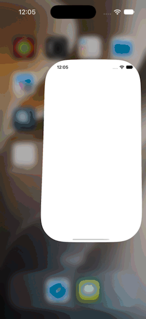

| The gallery | The fallback develops a file Apple can't open | Apple's decoder, same file |
|---|---|---|
| 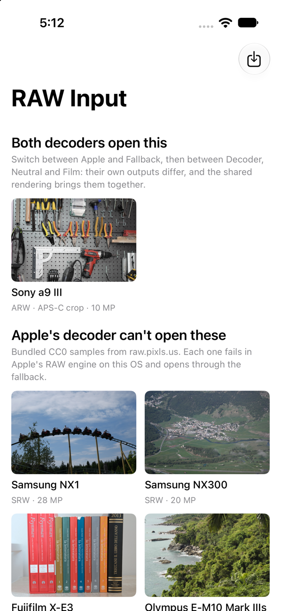 | 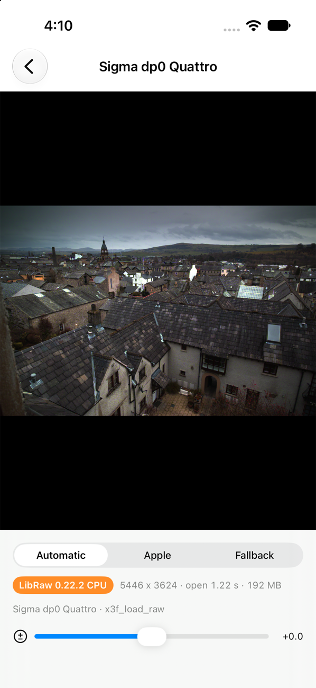 | 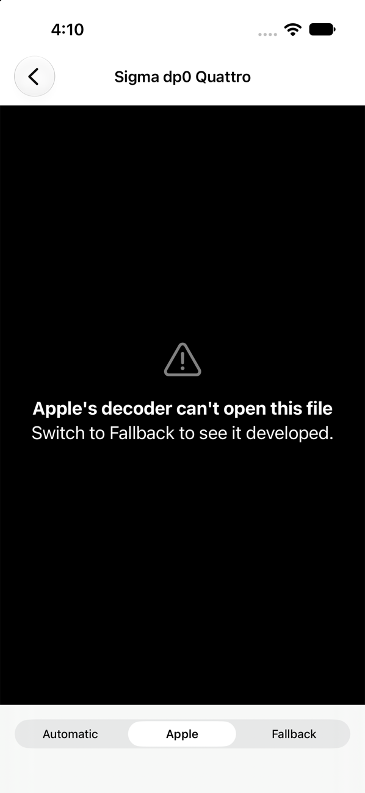 |

**Contents:** [Build and run](#build-and-run) · [Why](#why-this-for-vsco) ·
[What Apple opens and what it doesn't](#what-apple-opens-and-what-it-doesnt) ·
[Apple against the fallback](#apple-against-the-fallback-is-there-a-difference) ·
[One look for both decoders](#one-look-for-both-decoders) ·
[How it works](#how-it-works) · [Limits](#limits) · [Licence](#licence)

New to the code? Start with [Docs/ARCHITECTURE.md](Docs/ARCHITECTURE.md).

## Build and run

Requirements: macOS with Xcode 27 (Swift 6). iOS 17 or macOS 14 to run. No other tools.

```sh
git clone --recurse-submodules https://github.com/rlx/RawInputKit.git
cd RawInputKit
```

LibRaw is a git submodule. If you cloned without `--recurse-submodules`, run
`git submodule update --init`.

### The library

```sh
swift build
```

To use it in another project, add the package and import `RawInputKit`:

```swift
.package(url: "https://github.com/rlx/RawInputKit.git", branch: "main")
```

### The demo app

Open `Examples/RawInputDemo/RawInputDemo.xcodeproj` and run the `RawInputDemo` scheme on an
iPhone simulator or "My Mac". The first build downloads eleven sample files (285 MB) and
verifies their checksums.

To run on a phone, select the `RawInputDemo` target, choose your team under
Signing & Capabilities, and run. The phone needs Developer Mode switched on
(Settings → Privacy & Security).

The app opens on one file both decoders can open and ten that Apple's decoder rejects. Open
one and switch the decoder between Automatic, Apple and Fallback, and the rendering between
Decoder (each decoder's own output), Neutral and Film (the shared look). The exposure slider
works on the linear image. Import adds your own files from Files or a card reader.

### The tests

```sh
Examples/RawInputDemo/Scripts/fetch-samples.sh        # the demo's eleven files, 285 MB
Scripts/corpus.py fetch --only DMC-LX10_-_1_1         # one more, for the crop test, 22 MB
swift test
```

44 tests in 8 suites. Without the downloads, the suites that need files are skipped, with
the command that fetches them, and the rest still run. CI runs them on pushes to `main` and
on pull requests, with the sample files but without the crop-test file. On the iPhone
simulator:

```sh
xcodebuild test -scheme RawInputKit-Package -destination 'platform=iOS Simulator,name=iPhone 17 Pro'
```

### On a device

`xcrun devicectl list devices` gives the device's UDID. The team ID is the ten-character
code of the Apple developer team that signs the build; a free personal team works.

```sh
# The same 44 tests, on the device.
Scripts/device-tests.sh <device-udid> <team-id>

# Timings and peak memory. 15 app launches by default, one per measurement, which is
# what the comparison table below comes from; the second form measures everything
# three times, 102 launches.
Scripts/device-bench.py <device-udid>
Scripts/device-bench.py <device-udid> --limit 0 --runs 3
```

The tests run inside the demo app, because a device cannot run a Swift package's tests
directly. The benchmark needs the Release build of the demo installed first:

```sh
xcodebuild -project Examples/RawInputDemo/RawInputDemo.xcodeproj -scheme RawInputDemo \
    -configuration Release -destination 'id=<device-udid>' -derivedDataPath .build/device \
    DEVELOPMENT_TEAM=<team-id> -allowProvisioningUpdates build
xcrun devicectl device install app --device <device-udid> \
    .build/device/Build/Products/Release-iphoneos/RawInputDemo.app
```

### The measurements

Everything in the next two sections can be regenerated. The full archive is 19 GB.

```sh
Scripts/corpus.py fetch
swift run -c release rawprobe Tests/Corpus --json Tests/probe-results.json   # about 6 minutes
Scripts/coverage.py && Scripts/charts.py
```

`rawprobe` also looks at single files:

```sh
swift run -c release rawprobe render  FILE out.jpg [apple|fallback]   # develop one file
swift run -c release rawprobe compare FILE out.jpg                    # both decoders side by side
swift run -c release rawprobe looks   FILE out.jpg                    # both through the shared looks
swift run -c release rawprobe bench   FILE...                         # time and memory per decoder
swift run -c release rawprobe match   FILE...                         # how alike the two routes are
swift run -c release rawprobe fuzz    FILE... --iterations 800        # decode damaged copies
```

`Examples/RawInputDemo/Scripts/record-demo.sh` re-records the walkthrough GIF by running the
app's UI test in the simulator.

## Why this, for VSCO

VSCO Studio Pro imports JPEG and HEIC only. VSCO's own guide (22 September 2026) says "RAW
support is confirmed on the product roadmap" and tells RAW shooters to export JPEGs first;
the 1.3.0 release notes add tethering with "JPEG support only for now".
Sources: [Getting started with Studio Pro](https://www.vsco.co/learn/getting-started-vsco-studio-pro),
[App Store listing](https://apps.apple.com/us/app/vsco-studio-pro-photo-editor/id6759939220).

A RAW input stage is the piece between a file on a card and pixels an editor can grade. This
project is that stage, built to answer three questions with measurements:

1. How much does Apple's decoder already cover?
2. What is left over, and can a fallback fill it inside a closed-source App Store app?
3. What does the fallback cost in image quality, speed and memory?

## What Apple opens and what it doesn't

`rawprobe` ran both decoders over **944 files from 898 camera models**, all CC0 samples from
[raw.pixls.us](https://raw.pixls.us): one file for every camera in the archive, plus extra
compression modes for current bodies. Every file counts once, so a 2003 compact weighs the
same as this year's flagship: this is coverage of formats, not of what photographers shoot
today. Measured on macOS 27.0.1, Apple silicon. Apple
publishes a single camera list for iOS, iPadOS and macOS 27, and the ten bundled samples
were re-checked on an iPhone 16 Pro Max running iOS 27.0.1: Apple's decoder rejects all ten
there as well.

| | Files | Share |
|---|---|---|
| Apple's decoder opens it | 821 | 87% |
| Only the fallback opens it | 107 | 11% |
| Neither opens it | 16 | 2% |
| **Opened by RawInputKit** | **928** | **98%** |

Of the 821 that Apple opens, the fallback also opens 807.

<picture>
  <source media="(prefers-color-scheme: dark)" srcset="Docs/coverage-by-brand-dark.svg">
  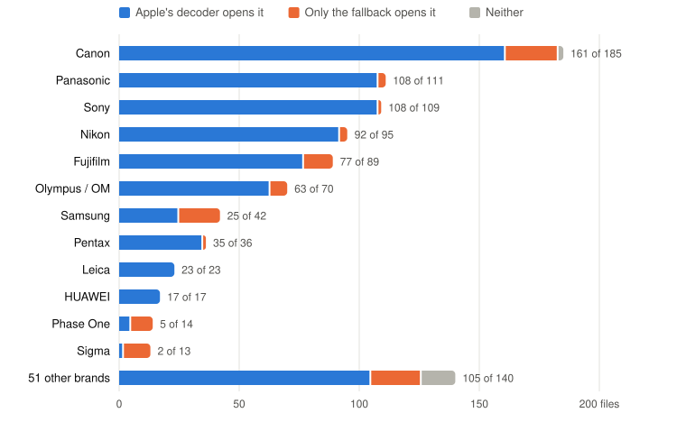
</picture>

| Brand | Files | Apple opens | | Only the fallback | Neither |
|---|---|---|---|---|---|
| Canon | 185 | 161 | 87% | 22 | 2 |
| Panasonic | 111 | 108 | 97% | 3 | 0 |
| Sony | 109 | 108 | 99% | 1 | 0 |
| Nikon | 95 | 92 | 97% | 3 | 0 |
| Fujifilm | 89 | 77 | 87% | 12 | 0 |
| Olympus / OM | 72 | 65 | 90% | 7 | 0 |
| Samsung | 42 | 25 | 60% | 17 | 0 |
| Pentax | 36 | 35 | 97% | 1 | 0 |
| Leica | 23 | 23 | 100% | 0 | 0 |
| Huawei | 17 | 17 | 100% | 0 | 0 |
| Phase One | 14 | 5 | 36% | 9 | 0 |
| Sigma | 13 | 2 | 15% | 11 | 0 |
| 42 other brands | 138 | 103 | 75% | 21 | 14 |

The complete lists, file by file, are in [Docs/coverage.md](Docs/coverage.md).

**Apple covers current cameras better than its reputation.** Forum posts and older articles
report that it cannot open Nikon High Efficiency or Fujifilm compressed RAF. On OS 27 it
opened all 4 High Efficiency files and 36 of the 37 compressed RAF files in the set. For
mainstream bodies, RAW support is a few lines of `CIRAWFilter`.

**What Apple does not open** (107 files the fallback does):

- *Formats it has almost never supported:* Sigma X3F from Foveon sensors (0 of 11 open),
  Kodak KDC (0 of 4) and DCR (1 of 5), and Samsung SRW, most of the NX line (3 of 20).
- *Particular modes of brands it does support:* most Phase One files in IIQ S and Sv2
  compression (9 of 14 Phase One files fail), one compressed RAF from the Fujifilm X-E3,
  and one of two reduced-size files from the Sony RX1R III, a 2025 camera.
- *Individual bodies:* Pentax K-3 Mark III Monochrome (2023), Olympus E-M10 Mark IIIs,
  DJI Osmo Action, and older Fujifilm EXR and SuperCCD cameras.
- *Raw dumps from hacked firmware:* 20 files from Canon compacts running CHDK, which write
  plain sensor dumps Canon's own software never produced.

**What the fallback does not open** that Apple does (14 files): Nikon High Efficiency, which
uses a patented codec; JPEG XL and lossy-JPEG DNG; one Sony a7 V file; two phone and
hobby-camera files; and five files where LibRaw reported corrupt data and RawInputKit refused
to return a partly garbled image. Neither decoder is a superset of the other, which is why
the order is Apple first.

**Neither opens** 16 files: eight GoPro GPR files, two more CHDK dumps from Canon compacts,
and six from action, dive and drone cameras, a digital film back and a cinema camera.

## Apple against the fallback: is there a difference?

Yes, in look, in speed and in how far each can be trusted. Compared on files both open.

### They look different

Left: Apple's decoder. Right: the fallback. Top: the whole frame. Bottom: a 1:1 crop.

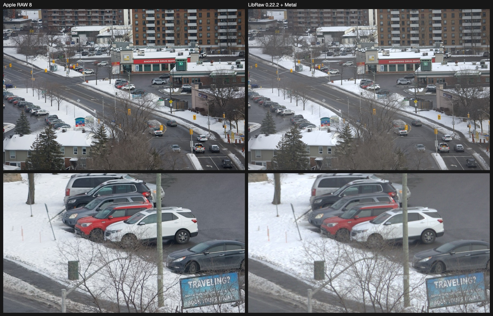

*Canon EOS R3, Bayer sensor, fallback on the GPU path.*

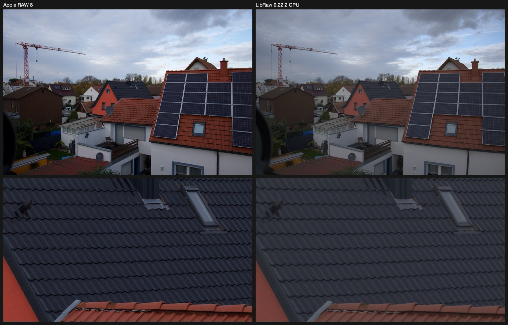

*Fujifilm X-T5, X-Trans sensor, fallback on the CPU path.*

Geometry and fine detail match. The look does not: Apple applies a tone curve, sharpening,
noise reduction and lens corrections (note the vignetting at the left edge of the Fujifilm
frame, corrected on Apple's side only). The fallback's image is scene-linear with nothing
added, so it is flatter and a little softer. That is by design, since an editor applies its
own look, but it means the two routes cannot be mixed in one gallery without a shared
rendering step on top.

### Their colours are close, Apple's closer

Almost every RAW file carries a preview the camera rendered, which makes it a reference for
whether a decode got the colours right. For the 744 files both decoders open and that carry
one, this is how far each lands from it, ignoring brightness:

<picture>
  <source media="(prefers-color-scheme: dark)" srcset="Docs/preview-agreement-dark.svg">
  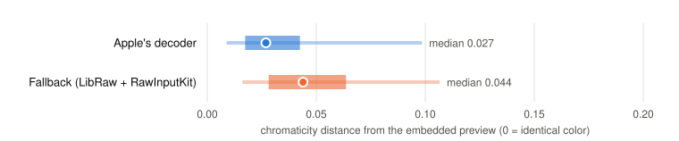
</picture>

Thick bar: the middle half of files. Thin bar: the middle 90%. Dot: the median, 0.027 for
Apple and 0.044 for the fallback. Both sit well under 0.15, where a result starts to look
wrong.

The same comparison flags results worth a second look, above 0.15: 8 of Apple's 754 and 15
of the fallback's 822. Seven files are flagged for both decoders, which points at the
preview being the odd one out more than at a bad decode. The clear fallback failures are cameras newer than
LibRaw's tables: it reads the Canon EOS R6 Mark III with the wrong black level and the
picture comes out with a pink haze. LibRaw "supporting 1,274 cameras" is an upper bound, not
a guarantee.

**The library runs this check itself.** Every fallback decode is compared with the file's
embedded preview and the result is on the image (`previewDistance`, `isColorSuspect`), so an
app can badge or refuse a picture that is probably wrong instead of showing it as fact. Apple
opens 13 of the fallback's 15 flagged files, so automatic routing never sends those to the
fallback in the first place.

### The GPU path is fast; the CPU path is not

Time from file to a fully rendered, full-resolution image: open the file, then render every
pixel to 8-bit sRGB, as an export would. Each measurement is its own process. "Apple" is
Apple's decoder on its own, called directly; RawInputKit's check of whether Apple can open a
file is not in it and is covered separately below.

**On an iPhone 16 Pro Max, iOS 27.0.1** (one launch per figure):

<picture>
  <source media="(prefers-color-scheme: dark)" srcset="Docs/speed-device-dark.svg">
  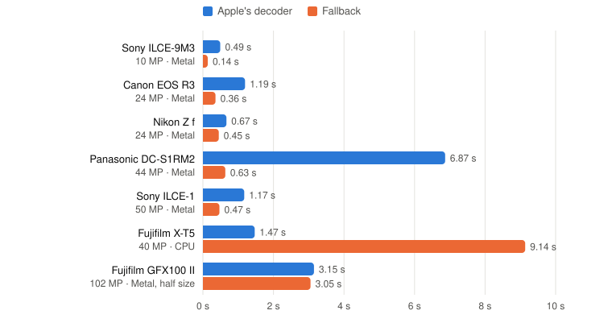
</picture>

| File | Fallback path | Apple | Fallback | Apple, next file | Fallback, next file | Apple peak memory | Fallback peak memory |
|---|---|---|---|---|---|---|---|
| Sony a9 III, 10 MP crop mode | GPU | 0.44 s | 0.18 s | 0.24 s | 0.12 s | 483 MB | 315 MB |
| Canon EOS R3, 24 MP | GPU | 1.45 s | 0.38 s | 0.72 s | 0.33 s | 907 MB | 525 MB |
| Nikon Z f, 24 MP | GPU | 0.60 s | 0.50 s | 0.44 s | 0.41 s | 538 MB | 529 MB |
| Panasonic S1R II, 44 MP | GPU | 6.36 s | 0.72 s | 1.05 s | 0.73 s | 679 MB | 811 MB |
| Sony a1, 50 MP | GPU | 1.13 s | 0.61 s | 0.95 s | 0.58 s | 703 MB | 909 MB |
| Fujifilm X-T5, 40 MP | CPU (X-Trans) | 1.09 s | 9.87 s | 0.85 s | 9.89 s | 722 MB | 1,268 MB |
| Fujifilm GFX100 II, 102 MP | GPU, half size | 2.21 s | 3.30 s | 2.00 s | 3.33 s | 1,306 MB | 810 MB |

"Next file" is the same decode done a second time in the same process: what every file
after the first costs once shaders and decoder state are warm.

**On an Apple silicon Mac, macOS 27.0.1** (median of three launches):

<picture>
  <source media="(prefers-color-scheme: dark)" srcset="Docs/speed-dark.svg">
  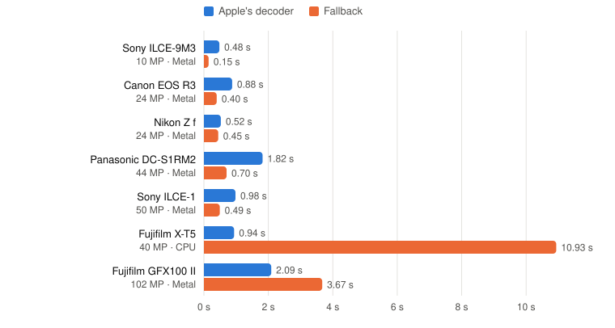
</picture>

| File | Fallback path | Apple | Apple via RawInputKit | Fallback | Apple peak memory | Fallback peak memory |
|---|---|---|---|---|---|---|
| Sony a9 III, 10 MP crop mode | GPU | 0.37 s | 0.47 s | 0.14 s | 1,279 MB | 376 MB |
| Canon EOS R3, 24 MP | GPU | 0.60 s | 0.87 s | 0.40 s | 2,147 MB | 688 MB |
| Nikon Z f, 24 MP | GPU | 0.43 s | 0.52 s | 0.45 s | 1,707 MB | 703 MB |
| Panasonic S1R II, 44 MP | GPU | 1.15 s | 1.81 s | 0.69 s | 3,674 MB | 1,393 MB |
| Sony a1, 50 MP | GPU | 0.88 s | 0.99 s | 0.49 s | 3,634 MB | 1,345 MB |
| Fujifilm X-T5, 40 MP | CPU (X-Trans) | 0.67 s | 0.95 s | 10.91 s | 2,510 MB | 1,674 MB |
| Fujifilm GFX100 II, 102 MP | GPU | 1.57 s | 2.12 s | 3.69 s | 6,040 MB | 2,837 MB |

"Apple via RawInputKit" is the same file through `RawInput.open` with automatic routing in
a fresh process, so it includes the check of whether Apple can open the file: 0.1 to 0.7 s
here. That check is paid once per camera and recording mode, then remembered.

What the numbers say:

- **On Bayer files up to 50 MP the fallback's GPU path is as fast as Apple's decoder or
  faster,** from a tie (Nikon Z f on the Mac) to about three times quicker. Apple does more per
  pixel: noise reduction, lens correction, tone mapping. The fallback's times include
  measuring exposure and checking its colours against the embedded preview.
- **At 102 MP the fallback is slower,** and on the phone it produces a quarter of the pixels
  (a half-size 25 MP image) while Apple renders all 102 MP. LibRaw's single-threaded
  decompression of that format is most of the time.
- **On X-Trans the fallback is nine to sixteen times slower.** It runs LibRaw's
  single-threaded CPU pipeline. Apple opens almost every X-Trans file, so this path is rare.
- **The phone keeps up with the Mac on the fallback.** The work is one GPU pass and
  single-threaded decompression, and an iPhone's cores are as fast as a Mac's at that.
- **Nothing was terminated for memory on the phone,** including the 102 MP frame.
- **Apple's decoder uses far more memory on the Mac** than on the phone for the same file:
  it scales its working set to the machine.
- **Apple's decoder has a first-use cost per camera, and for one it is large.** The first
  Panasonic S1R II decode in a process took 6.4 s on the phone and the next one 1.1 s; every
  launch that measured it, seven across the day, showed the same. The time goes in setting the decoder up,
  before any pixel is requested, and I could not see what it is doing. The other cameras
  lose about 0.7 s or less. An app would want to pay this off the main thread, before the user is
  waiting.

The phone figures are single launches, so differences of a tenth of a second between two
rows mean little; the Canon EOS R3's first Apple decode measured 1.1 s in an earlier run.
Peak memory includes the benchmark's own output buffer, 4 bytes per pixel.

The ten samples Apple's decoder rejects, on the same iPhone, through the fallback (median of
three launches, except the first row):

| Sample | Path | Embedded preview | File to rendered image | Peak memory |
|---|---|---|---|---|
| Samsung NX1, 28 MP | GPU | 53 ms | 0.66 s | 582 MB |
| Samsung NX300, 20 MP | GPU | 44 ms | 0.37 s | 436 MB |
| Fujifilm X-E3, 24 MP | CPU | 26 ms | 5.15 s | 697 MB |
| Olympus E-M10 Mark IIIs, 12 MP | GPU | 30 ms | 0.39 s | 281 MB |
| Panasonic DC-FZ45, 18 MP | GPU | 34 ms | 0.23 s | 384 MB |
| Sigma dp0 Quattro, 20 MP | CPU | 57 ms | 1.03 s | 784 MB |
| Pentax K-3 Mark III Monochrome, 26 MP | CPU | 52 ms | 0.60 s | 641 MB |
| Phase One IQ180, 20 MP | CPU | 44 ms | 1.47 s | 617 MB |
| Canon PowerShot S100V, 12 MP | GPU | 29 ms | 0.30 s | 271 MB |
| DJI Osmo Action, 12 MP | GPU | 28 ms | 0.14 s | 266 MB |

Only the first row was measured after the fallback gained its exposure measurement and
colour check; the other nine predate them and would each be 0.04 to 0.15 s slower now (the
Samsung NX1 went from 0.51 s to 0.66 s).

The embedded preview takes 24 to 79 ms across every file measured on the phone, which is
what makes a gallery usable before anything is developed.

### Summary

| | Apple's decoder | The fallback |
|---|---|---|
| Files opened, of 944 | 821 | 914 |
| Look, out of the decoder | Finished: tone curve, sharpening, lens corrections | Scene-linear and flat |
| Look, after the shared rendering | Close: a median colour difference of ΔE 3 between the two | |
| Colour distance from the camera's preview, median | 0.027 | 0.044 |
| Results flagged against the camera's preview | 8 of 754 | 15 of 822 |
| Speed on Bayer files up to 50 MP, iPhone 16 Pro Max | 0.4 to 1.5 s, 6.4 s for one camera's first decode | 0.2 to 0.7 s |
| Speed on X-Trans, 40 MP, iPhone 16 Pro Max | 1.1 s | 9.9 s |
| New cameras | Arrive with OS updates | Arrive with LibRaw releases, and can decode wrongly before then |
| Cost to ship | None | LibRaw under CDDL, about 1 MB of code, a look to build |

## One look for both decoders

The comparison above is the problem with having two decoders: Apple's hands back a finished
picture, the fallback hands back flat sensor data, and a gallery mixing them would show two
kinds of photograph. The fix is to not let either decoder decide the look.

`RawLook` is one rendering step applied after the decoder: exposure, measured the same way
for both, then a tone curve and style baked into a lookup table. Ask Apple's decoder for
scene-linear output, and both routes feed it the same kind of data.

```swift
var options = RawDecodeOptions()
options.appleRendering = .linear             // scene-linear from Apple too
let raw = try RawInput.open(url, options: options)
let picture = raw.rendered(look: .film)      // or .neutral, or your own RawLook
```

Left: Apple's decoder. Right: the fallback. Top row: what each produces on its own. Below:
the same two decodes through the shared neutral look, then the shared film look.

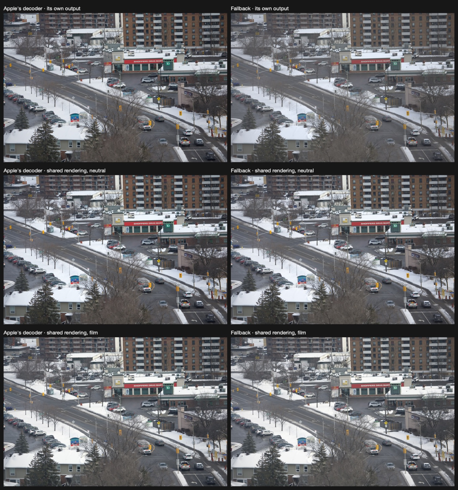

Measured on 202 files both decoders open (every fourth one), as the colour difference
between the two routes' pictures:

<picture>
  <source media="(prefers-color-scheme: dark)" srcset="Docs/route-match-dark.svg">
  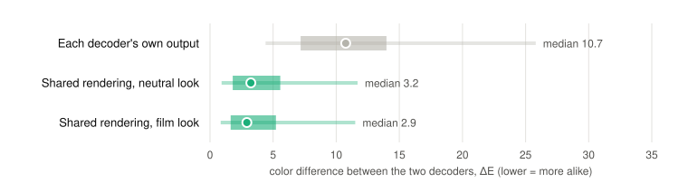
</picture>

ΔE is the usual measure of how different two colours look (CIELAB, 1976 formula): about 1 is
the smallest difference visible side by side, and above 10 the colours are plainly
different. Here it is the mean over a 24 by 16 grid of area averages, so it measures colour
and tone across the frame and is blind to sharpness, noise and local distortion. Out of the
decoders the two routes differ by a median of 10.7. Through the shared look that falls to
3.2 (neutral) and 2.9 (film), and the routes come closer on 193 of the 202 files.

A difference of 3 is still visible if you flip between the two. What remains is real: the
decoders use different colour matrices, and Apple applies lens corrections and noise
reduction that the fallback does not. Those are the next things to build if the routes must
be indistinguishable. The looks themselves are a contrast curve, saturation, two tints and a
fade; a product would put its own presets here.

## How it works

```
RawInput.open(url)
   │
   ├─ Can Apple develop it?  Render a small region and see whether pixels come out.
   │
   ├─ yes ─ CIRAWFilter ──────────────────────────────────┐
   │                                                      ├─▶ RawImage: linear CIImage, info, route
   └─ no ── RawShim (C boundary) ─ LibRaw decompresses    │
              ├─ plain Bayer ───── Metal compute kernel ──┤
              └─ everything else ─ LibRaw CPU pipeline ───┘
```

- **Routing is by probe, not by camera name.** Support depends on the compression mode, which
  Apple's camera list does not record, and `CIRAWFilter` is lazy: for an unsupported file it
  can return an image that renders as nothing. The router asks Apple's engine for a small
  region of real pixels. That costs a good part of a decode, so the answer is remembered per
  camera and recording mode and the next file of the same kind skips the test.
- **Bayer files are developed on the GPU.** One Metal kernel does black level, white balance,
  edge-directed (Hamilton-Adams) demosaicing and the camera-to-sRGB matrix, into 16-bit
  float. The better-known demosaic algorithms are GPL and are not used.
- **Everything else uses LibRaw's own pipeline:** X-Trans, Foveon, monochrome sensors, and
  Phase One backs, which need per-sensor corrections only LibRaw applies.
- **In-camera crops are honoured** on Bayer and full-colour sensors, so a file shot at 1:1
  comes out square on both routes. X-Trans files are left at the full frame.
- **Malformed files are validated, not trusted.** Sizes, margins and levels are checked
  before they reach the GPU, and data that LibRaw reports as corrupt is an error instead of
  a half-garbled image.
- **Rendering comes after decoding, once.** Neither decoder decides the look. Exposure is
  measured from the pixels by the same function for both routes, and a `RawLook` turns the
  linear data into a picture.
- **The fallback checks its own work.** LibRaw can decode a camera it does not properly know
  and return a tinted picture without complaint, so every fallback result is compared with
  the camera's embedded preview and flagged if they disagree.
- **A C seam.** Swift reaches LibRaw only through `Sources/RawShim/include/RawShim.h`. No C++
  type crosses it, so the same core could sit under a Rust or C++ engine.

[Docs/ARCHITECTURE.md](Docs/ARCHITECTURE.md) has the code map, the conventions, and how-to
notes for debugging a decode, updating LibRaw and regenerating the numbers.

## The bundled samples

The demo ships with eleven files. One, a Sony a9 III frame, opens in both decoders and is
there for comparing them. The other ten fail in Apple's decoder and develop on the fallback;
a test asserts both, on the Mac, the simulator and the phone.

| Sample | Format | Fallback path |
|---|---|---|
| Samsung NX1 | SRW, 28 MP | GPU |
| Samsung NX300 | SRW, 20 MP | GPU |
| Fujifilm X-E3 | RAF compressed, X-Trans, 24 MP | CPU |
| Olympus E-M10 Mark IIIs | ORF, 16:9 in-camera crop, 12 MP | GPU |
| Panasonic DC-FZ45 | RW2, 18 MP | GPU |
| Sigma dp0 Quattro | X3F, Foveon, 20 MP | CPU |
| Pentax K-3 Mark III Monochrome | PEF, monochrome sensor, 26 MP | CPU |
| Phase One IQ180 | IIQ Sv2, 20 MP | CPU |
| Canon PowerShot S100V | CR2, 12 MP | GPU |
| DJI Osmo Action | DNG, 12 MP | GPU |

These are what the measurements turned up, not the cameras people buy today: nearly all
recent mainstream bodies in the set open in Apple's decoder.

## Limits

- **The two routes match to a median ΔE of 3, not exactly.** The fallback has no lens
  correction, noise reduction or highlight recovery, and uses LibRaw's colour matrices where
  Apple uses its own. Closing that is the largest piece of work between this and a product.
- **The looks are deliberately simple:** a curve, saturation, tints and a fade.
- **X-Trans and Foveon are slow,** seconds per frame on one CPU core.
- **The colour check needs an embedded preview** and reports, it does not refuse. A file
  without a preview is not checked, and about one decode in a hundred is flagged although
  both decoders agree with each other, because the preview itself is the odd one out.
- **Truncated files are not always caught.** LibRaw reports corrupt data for compressed
  formats, and those are refused. For uncompressed ones it reads what is there and leaves
  the rest of the frame empty, and the fallback returns that image without complaint.
- **Fuzzing is shallow.** 800 seeded, damaged copies of eight real files produced no crash
  and no hang. That exercises this project's handling of sizes and levels; it is not
  coverage-guided fuzzing of LibRaw.
- **Large frames are halved.** Above 64 MP the fallback develops mosaic sensors (Bayer and
  X-Trans) at half size to stay within a smaller phone's memory. Foveon, monochrome and
  already-demosaiced files are not reduced.
- **Measured on one phone,** an iPhone 16 Pro Max with 8 GB of memory. Older phones with
  less memory are where the 64 MP half-size threshold will matter, and they are untested.
- **RAW 9,** Apple's newer decoder, is offered on the test machine for DNG only. The
  `appleDecoderVersion = .newest` option selects it; nothing else here exercises it.
- LibRaw's sources compile with deprecation warnings that SwiftPM offers no safe way to
  silence. RawInputKit's own code compiles without warnings.
- **Requires Xcode 27.** It has not been built with older toolchains.

## Licence

RawInputKit is under the [MIT licence](LICENSE).

It links LibRaw 0.22.2, used under LibRaw's CDDL-1.0 option, which permits static linking
into a closed-source App Store app without the relinking obligation of the LGPL. LibRaw is
included unmodified as a submodule. Details in
[THIRD-PARTY-NOTICES.md](THIRD-PARTY-NOTICES.md). Get a lawyer's confirmation before
shipping a product on this.

The sample images are CC0, from raw.pixls.us, and are downloaded, not redistributed here.
